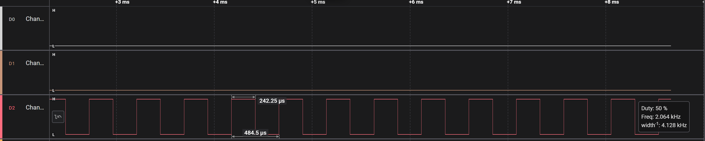
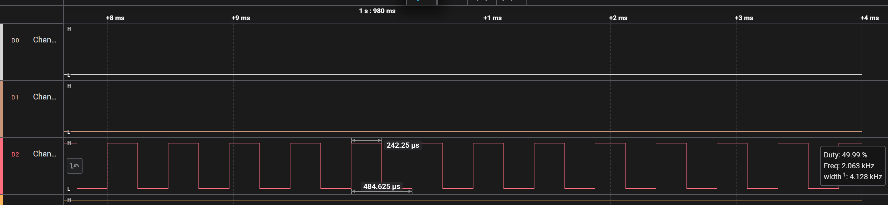
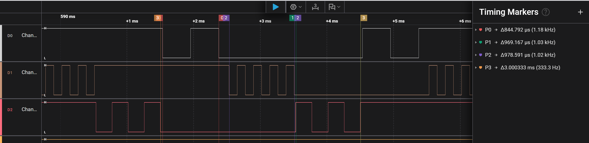
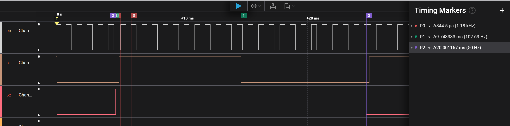
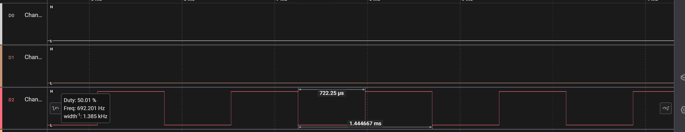

# Report — Week 1 / Ex2

`student_id`: 2413062    Commit của PREDICTION.md: ______

## 1. CPU share đo được
| Cấu hình | A (%) | B (%) | C (%) | Time slice đo được | Ảnh |
|---|---|---|---|---|---|
| B2: preempt=1, ưu tiên khác nhau | 0 | 0 | 100 | — |  |
| B3: preempt=0, ưu tiên khác nhau | 0 | 0 | 100 | — | |
| B4: preempt=1, cùng ưu tiên | 30.25 | 35.04 | 34.71 | ms | |
| B5: sau khi sửa starvation | 1% | 1%| |98%||

Cách tính CPU share từ ảnh PulseView (mô tả ngắn):
- thời gian task hoạt động trong 1 thời gian nhất định chia cho tổng thời gian cửa sổ
## 2. Preemption nhìn thấy ở đâu
Trên ảnh **bước 4** (cùng ưu tiên, round-robin), chỉ ra ít nhất **2 thời điểm**
preemption xảy ra. Với mỗi thời điểm: dấu thời gian, task bị cắt, task chiếm CPU,
và vì sao (hết time slice, không phải block).

| t (us) | Task bị preempt | Task chiếm CPU | Lý do |
|595901|Task B| Task C |hết time slice |
|596892 | Task C | Task A | hết time slice |

Ở **bước 2** (ưu tiên khác nhau, đều busy-loop không block): giải thích vì sao ảnh
của bạn cho thấy **0 thời điểm preemption**, dù chạy bao lâu đi nữa — dựa vào điều
kiện preemption của FreeRTOS, không phải "vì ảnh chụp chưa đủ dài".
- Vì ở bước 2, configUSE_PREEMPTION = 1 nhưng task C có priority cao nhất nên luôn chạy busy-loop, không block, yield. 
## 3. Time slice
Time slice đo được ở bước 4: __0.974____ ms. `configTICK_RATE_HZ` = __1 ms____.
Sai số: __2.6____ %. Giải thích sai số:
- Sai số có thể do xung nhịp vì logic analyzer và MCU có 2 clock khác nhau.
## 4. DWT wrap-around
Tại sao so sánh `DWT->CYCCNT > target` bị sai sau ~59 giây, và cách viết đúng:
- CYCCNT là 1 thanh ghi đếm 32 bit, giá trị lớn nhất trước khi reset là 2^32-1 => chu kì wrap-around =(2^32-1)/(72000000)=59.65s.
- Sau khoảng 59s, CYCCNT sẽ quay về 0. Nếu sau đó ta vẫn dùng so sánh DWT ->CYCCNT >target sẽ bị sai do đã bị reset về 0.
- Cách viết đúng: đo chu kì bằng phép trừ unsigned:  
    const uint32_t start = DWT->CYCCNT;
    while ((uint32_t)(DWT->CYCCNT - start) < ticks) {}
- Với start là giá trị bộ đếm bắt đầu. Với phép trừ unsigned sẽ không tính sai sau 59s ( sau khi CYCCNT reset về 0).
## 5. Sửa starvation
Cách tôi chọn: __dùng thêm vTaskDelay cho Task B,C để tất cả các task đều thực thi được____
Vì sao nó hoạt động (dựa vào trạng thái task trong scheduler):
Đánh đổi: 
- Các task B và C phải có độ trễ phản hồi lâu hơn, task C không lúc nào cũng ready như trước mà phải block để các task khác thực hiện.
## 6. Lệch so với dự đoán
Mỗi mục lệch + nguyên nhân vật lý.
| Mục | Dự đoán | Đo được | Nguyên nhân vật lý |
|---|---|---|---|
| Time slice (B4) | 1.000 ms | 0.974 ms (−2.6%) | có thể do quá trình ISR và PendSV gây sai số  |
| CPU share (B4) | 33.3% mỗi task | A 30.25, B 35.04, C 34.71 | do quá trình context switch của hàm vTaskDelay |
## 7. Câu hỏi đánh đổi
Với **bộ ưu tiên của bạn**, nếu `TASK_C_WORK_US` tăng gấp 3 lần thì bảng CPU share ở
bước 2 thay đổi thế nào? Trả lời bằng số suy ra từ dữ liệu của bạn, rồi **đo lại để
kiểm chứng**. Nếu lệch, giải thích.
- Khi tăng gấp 3 lần thì bảng CPU vẫn là Task A = 0%, Task B = 0%, Task C = 100%. Vì: khi đó chỉ làm tăng thời gian mức 1 của task C chứ không làm thay đổi 2 task còn lại ( C vẫn là task có ưu tiên cao nhất và khi không bị block/ yield thì task này vẫn thực hiện, 2 task kia vẫn bị starvation). 
- Kiểm chứng:
