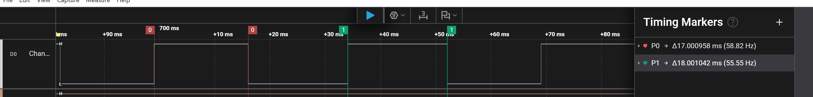
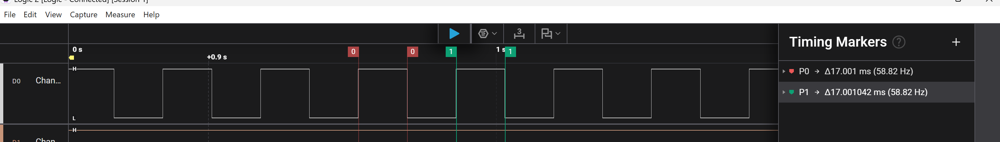
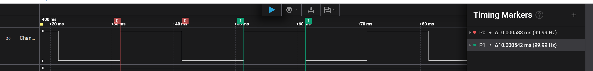
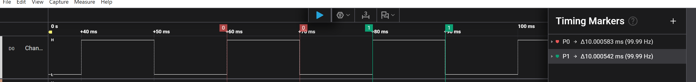

# Report — Week 1 / Ex3

`student_id`: 2413062    Commit của PREDICTION.md: ______

## 1. Bảng thống kê (tính từ CSV, không đọc tay)
| # | Delay | Tick | min (ms) | max (ms) | tb (ms) | jitter = max−min (us) | drift tổng (ms) |
|---|---|---|---|---|---|---|---|
| 1 | `vTaskDelay` | 1000 | 17.0009 | 18.0012 | 17.4710 | 1000.249 | 471  |
| 2 | `xTaskDelayUntil` | 1000 | 17.0010 | 17.0010 | 17.0010 | 0.084 | 1.01 |
| 3 | `vTaskDelay` | 100 | 10.0005 | 10.0007  | 10.0006 | 0.167 | 0.60 |
| 4 | `xTaskDelayUntil` | 100 | 10.0005 | 10.0007 | 10.0006 | 0.209 | 0.60 |

- Script dùng để tính: [`toggle_stats.py`](app/toggle_stats.py)
- CSV gốc: [file_csv](file_csv/) (commit kèm)
- Ảnh: 
- **conf1: `vTaskDelay`, 1 kHz**

**conf2: `xTaskDelayUntil`, 1 kHz**

**conf3: `vTaskDelay`, 100 Hz**

**conf4: `xTaskDelayUntil`, 100 Hz**

## 2. Tại sao `vTaskDelay` bị drift
Công thức drift theo `PERIOD_MS` và `WORK_JITTER_US` của **bạn**, rồi so với số đo:

| | Tính theo công thức (us) | Đo được (us) | Lệch (us) |
|---|---|---|---|
| Drift tổng (ms) | 444 | 471 | 27 |

## 3. Tại sao tick 100 Hz sai nhiều hơn
`PERIOD_MS` = __17__ ; một tick = __10__ ms. Chứng minh bằng số đo, không bằng lý thuyết:
| | Mong muốn | Đo được (config 3, 4) |
|---|---|---|
| Chu kỳ tb (ms) | 17 | 10.0006 |
| Sai lệch mỗi chu kỳ (ms) | 0 | 6.9994 |
| Drift tổng, N = 1000 (ms)| 0 | 6999.4 |
- Ở 100Hz, 1 chu kì trung bình đo được là 10.0006ms so với `PERIOD_MS` LÀ 17ms ( lệch 6.9994ms ). Drift tổng sau `SAMPLE_COUNT` cũng sai hơn 1kHz ( config 1) (6999.4 ms so với 471ms ). 
## 4. `xTaskDelayUntil` trả về gì
Giá trị trả về nghĩa là gì, và trong 4 lần chạy của bạn nó có bao giờ báo
"đã trễ deadline" không? Bao nhiêu lần / `SAMPLE_COUNT`?
- `xTaskDelayUntil`sẽ trả về pdTRUE khi task được đánh thức đúng thời điểm dự kiến, pdFalse khi được đánh thức sau thời gian dự kiến hay " trễ deadline".
- Trong 4 lần chạy, chỉ có config 2, 4 là dùng `xTaskDelayUntil` và không có lần nào báo đã trễ deadline. 0/`SAMPLE_COUNT`.
## 5. Lệch so với dự đoán
| # | Lệch so với dự đoán | Nguyên nhân vật lý |
|---:|---|---|
| 1 | `17.4710 - 17 = +0.4710 ms`; jitter = `1000.249 µs` | dùng `vTaskDelay()` khi có `WORK_JITTER_US`lớn hơn `PERIOD_MS` sẽ làm trễ chu kì |
| 2 | `17.0010 - 17 = +0.0010 ms`; jitter = `0.084 µs` | `xTaskDelayUntil()` dùng mốc thời gian tuyệt đối nên hạn chế tích lũy thời gian thực thi. Sai số nhỏ có thể do clock MCU và độ phân giải thiết bị đo|
| 3 | `10.0006 - 10 = +0.0006 ms`; jitter = `0.167 µs` | `vTaskDelay()` có độ trễ tương đối; sai lệch nhỏ có thể do clock và phép đo |
| 4 | `10.0006 - 10 = +0.0006 ms`; jitter = `0.209 µs` | `xTaskDelayUntil()` giữ lịch theo mốc tuyệt đối. Sai lệch có thể do clock và thiết bị đo |

## 6. Câu hỏi đánh đổi
Tick 1000 Hz cho độ chính xác tốt hơn nhưng **tốn** gì? Dựa vào dữ liệu của bạn:
đo CPU overhead của tick ISR ở 100 Hz và 1000 Hz (gợi ý: cho một task ưu tiên thấp
nhất đếm vòng lặp trong 1 giây, so sánh 2 cấu hình). Điền số:

| Tick rate | Số vòng lặp idle đếm được trong 1 s | Overhead suy ra (%) |
|---|---|---|
| 100 Hz | 3 408 865  | 0,025 |
| 1000 Hz | 3 401 182 | 0,250  |

Với ứng dụng `PERIOD_MS` = __17__ của bạn, bạn chọn tick rate nào? Bảo vệ bằng số trên.
- chọn tick 1kHz vì:
- Nếu chọn tick 100Hz thì sẽ có sai lệch lớn (41.17%) so với chu kì tick 1000Hz (17.0010 so với 10.0006).
- Đánh đổi: do tick 1000Hz thì số vòng lặp trong 1s là 3,401,182 so với 100Hz (3,408,865), chênh lệch số vòng lặp khoảng 0.225%. Dù overhead tăng nhưng vẫn có thể chấp nhận để có thời gian chính xác.