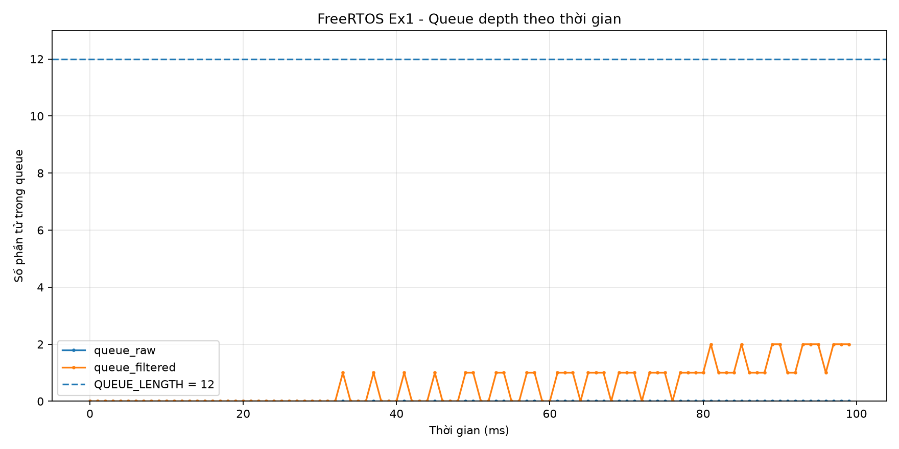
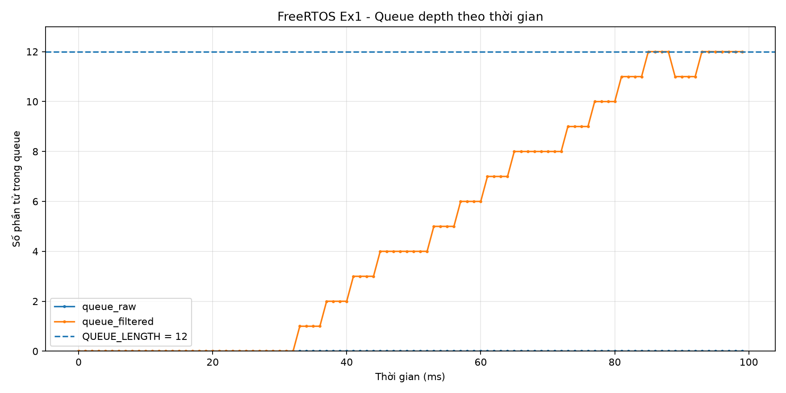

# Report — Week 2 / Ex1

`student_id`: __2413062____    Commit của PREDICTION.md: ______

## 1. Kích thước queue tối thiểu
| | Dự đoán | Đo được | Khớp? |
|---|---|---|---|
| `queue_raw` | 1 | 0 | không khớp |
| `queue_filtered` | 1 | 1 | khớp |

Nếu lệch: nguyên nhân (thời gian xử lý thực tế khác ước lượng, jitter I2C, ...).
- queue_filtered lệch do ước lượng ban đầu chưa chính xác về thời gian truyền UART và tốc độ cpu xử lí mẫu và thời gian từ lúc nhận mẫu đến lúc gửi mẫu lên queue.
- queue_raw lệch do tốc độ xử lí và lấy mẫu từ queue đủ nhanh nên queue chưa có dữ liệu đã lấy để xử lí.
## 2. Đồ thị độ đầy queue theo thời gian
Cấu hình bình thường: 
Cấu hình UART chậm (9600 baud): 
Giải thích hình dạng đồ thị ở mỗi cấu hình.
- Do tốc độ xử lí và lấy mẫu nhanh nên queue_raw chưa có dữ liệu và để xử lí trong cả 2 đồ thị.
- Với đồ thị 57600baud thì queue dao động trong khoảng từ 0-2 mẫu trong còn với baud thấp hơn là 9600 thì số mẫu trong queue sẽ tăng dần đến QUEUE_LENGTH =12 và tràn queue. Nguyên nhân là do UART gửi dữ liệu chậm hơn so với tốc độ truyền dữ liệu của sensor khiến cho queue_filtered bị đầy. 
## 3. Khi nào queue đầy
Mô tả **chính xác** thời điểm `queue_filtered` bắt đầu đầy khi hạ baud, và số
mẫu bị mất/trễ (đếm bằng số thứ tự mẫu gắn trong payload).
- Ở baud 9600, mẫu đầu tiên bị từ chối xuất hiện tại tick 85 ms.
- Số mẫu bị mất/ trễ đầu tiên là thứ 12.
## 4. Hành vi 3 kiểu timeout
| Timeout | Kết quả quan sát khi queue đầy |
|---|---|
| 0 | filter_task không bao giờ bị chặn, xQueueSend trả về errQUEUE_FULL ngay nên mẫu mới bị bỏ. |
| giá trị hữu hạn |Task sẽ block và chờ queue hết đầy đến thời gian tối đa mà ta thiết lập |
| `portMAX_DELAY` |filter_task chờ đến khi có chỗ trống và task sẽ block, task chờ vô thời hạn |

## 5. Lệch so với dự đoán
Mỗi mục lệch + nguyên nhân vật lý.
| Mục lệch | nguyên nhân vật lý |
|---|---|
| queue_raw | do ước lượng sai thời gian sensor_task|

## 6. Câu hỏi đánh đổi
Với `SAMPLE_PERIOD_MS` của **bạn**, nếu `FILTER_WINDOW` tăng gấp đôi thì độ trễ
từ cảm biến đến UART tăng thêm bao nhiêu ms? Trả lời bằng số từ dữ liệu của bạn,
rồi đo lại để kiểm chứng.
