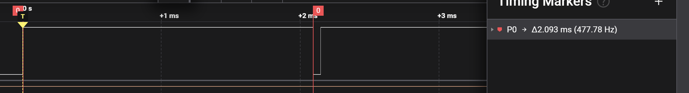
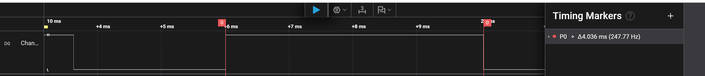
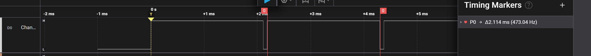

# Report — Week 2 / Ex2

`student_id`: __2413062____    Commit của PREDICTION.md: ______

## 1. Lỗi tái hiện (UART_GUARD_MODE = 0)
Log UART dán nguyên văn, đánh dấu vị trí ký tự lẫn lộn:

```
    W1 #851 *
    W0 #1705 
    W1 #1706
    W2 #1707
    W0 #1708
    W1 #1709
```

Tái hiện lại bao nhiêu lần / bao nhiêu lần thấy lỗi: __2____ / __2____.

## 2. Bảng so sánh 3 cách
| Cách | Độ trễ in trung bình (us) | Độ trễ in max (us) | Ảnh hưởng task khác | RAM thêm so với critical section (bytes) |
|---|---|---|---|---|
| Mutex | 3824.7 | 4277.0 | 7036 | 96 |
| Critical section | 2093.83 | 2098.0 | 6857 | 0 |
| Gatekeeper | 2114.83 | 2119.0 | 6379 | 978  |

Cách đo độ trễ in (mô tả ngắn, kèm ảnh logic analyzer nếu dùng pin đánh dấu):



- Mô tả: 
+ Đối với critical, mình đặt chân GPIO mức cao trước khi vào taskENTER_CRITICAL() và trở về low khi truyền xong.
+ Đối với mutex, mình đặt chân GPIO mức cao trước khi gọi semaphore và trở về low khi truyền xong.
+ Đối với gatekeeper, mình đặt chân GPIO mức cao trước khi gọi queue và trở về low khi truyền xong.
## 3. Vì sao critical section nguy hiểm nhất
Giải thích bằng số đo của bạn: đoạn in dài bao nhiêu us khi ở trong critical
section, và điều đó chặn ngắt nào trong hệ thống bao lâu.
- Đoạn in dài 2093.83 us ở trong critical section và chặn ngắt thuộc phạm vi mask cũng trong khoảng thời gian này.
## 4. Lệch so với dự đoán
Mỗi mục lệch + nguyên nhân vật lý.
|mục|lệch|nguyên nhân|
|---|---|---|
|RAM thêm| critical không lệch, mutex dùng thêm 96 byte, gatekeeper dùng thêm 978 byte | do critical không tạo thêm gì, mutex tạo thêm mutex control block, gatekeeper tạo thêm gatekeeper task|
## 5. Câu hỏi đánh đổi
Với `WRITER_COUNT` của **bạn**, nếu tăng gấp đôi thì cách nào bị ảnh hưởng độ trễ
nhiều nhất? Trả lời bằng số từ dữ liệu của bạn, rồi đo lại để kiểm chứng.
- cách mutex sẽ ảnh hưởng nhiều nhất.
- Dữ liệu:
|Trường hợp| độ trễ trung bình 3 task | độ trễ max 3 task | độ trễ trung bình 6 task | độ trễ max 6 task |
|---|---|---|---|---|---|
|Mutex| 7624 | 9036 | 14272 | 15306 |
|Critical section | 11094 | 11095 | 17094 | 17095|
|Gatekeeper| 11115 | 11119 | 15514 | 16632|