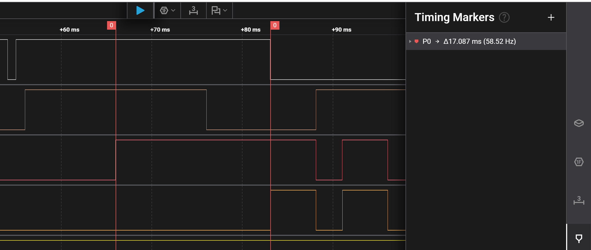
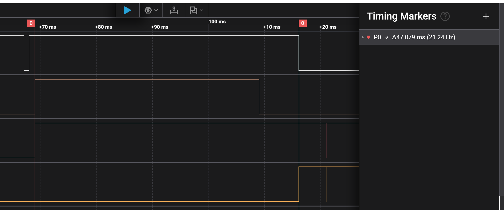

# Report — Week 2 / Ex3

`student_id`: __2413062____    Commit của PREDICTION.md: ______

## 1. Ảnh đo
Binary semaphore: 
Mutex: 
Trên mỗi ảnh, đánh dấu: thời điểm `task_high` sẵn sàng chạy (t0), thời điểm nó
thực sự chạy (t1). Thời gian block = t1 − t0.
- Thời gian block là khoảng thời gian được đánh dấu trong hình. Thời gian block tính bằng khoảng thời gian từ thời điểm muốn take semaphore(kênh 2) đến thời điểm bắt đầu thực thi task(kênh 3, PA11).
## 2. Bảng thời gian block
| Cấu hình | t0 (us) | t1 (us) | Block (us) | Đạt `DEADLINE_MS`? |
|---|---|---|---|---|
| Binary semaphore | 66 962 | 84 049  | 17 087 | không đạt |
| Mutex | 30 025 | 37097 | 7 072 | đạt |

## 3. Vì sao mutex ngắn hơn
Giải thích bằng priority inheritance: `task_low` được nâng lên ưu tiên nào, khi
nào, và việc đó ngăn `task_mid` chen vào như thế nào.
- Task low sẽ được tạm thời nâng độ ưu tiên lên bằng với task_high, khi task_high muốn take semaphore, việc đó ngăn task_mid phải chờ phần còn lại của task_low + task_high mới thực thi tiếp phần còn lại của task_mid.
## 4. task_mid trong lúc inversion
Mô tả trạng thái kênh `task_mid` trên ảnh binary semaphore trong khoảng
inversion — chạy bao nhiêu lần, mỗi lần bao lâu.
- Theo cấu hình semaphore trong khoảng inversion sẽ chạy 1 lần liên tục, mỗi lần trong `MID_WORK_MS`=20ms. Task sẽ chạy liên tục vì trong khoảng thời gian inversion, không có task nào ready có priority cao hơn task_mid. 
## 5. Lệch so với dự đoán
Mỗi mục lệch + nguyên nhân vật lý.
|đai lượng|lí thuyết|đo đạc|lệch|nguyên nhân|
|---|---|---|---|---|
|thời gian task_high block (binary semaphore)|28ms|17.087ms|10.913|lí thuyết dự đoán thời gian block lớn nhất lúc task_high muốn take semaphore ngay lúc bắt đầu task_low|
|thời gian task_high block (mutex)|8ms|7.072|0.928|do dự đoán thời gian block lớn nhất|
## 6. Câu hỏi đánh đổi
Với bộ tham số của **bạn**, nếu `MID_WORK_MS` tăng gấp đôi thì thời gian block ở
cấu hình binary semaphore tăng thêm bao nhiêu? Trả lời bằng số từ dữ liệu của
bạn, rồi đo lại để kiểm chứng. `task_high` còn đạt `DEADLINE_MS` không?
- Nếu tăng  `MID_WORK_MS` tăng lên gấp đôi thành 40ms thì thời gian block sẽ tăng lên tối đa: 40+8=48ms > `DEADLINE_MS` => không đạt.
- Kiểm chứng: 

- Ta đi được 47.079ms và không đạt `DEADLINE_MS`.