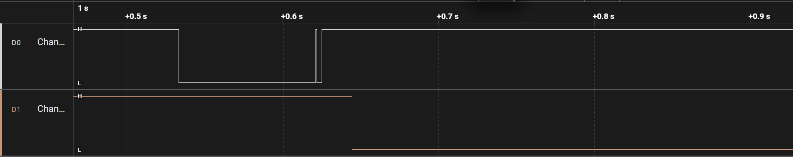
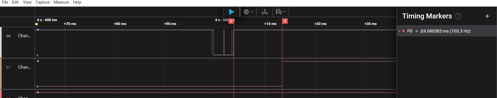

# Report — Week 3 / Ex2

`student_id`: __2413062____    Commit của PREDICTION.md: __7/11/2026____

## 1. Nảy phím trước/sau
Ảnh logic analyzer: tín hiệu thô (nhiều cạnh nảy) và tín hiệu "PRESS" sau khi
qua `debounce_timer` (một cạnh sạch).
Ành minh chứng:  
## 2. Callback bị block — thí nghiệm bước 4
| Dự đoán | Đo được |
|---|---|---|
| Độ trễ `longpress_callback` khi `debounce_callback` block 50ms | 50ms | 33ms |
Log timestamp (`xTaskGetTickCount()`) của cả hai callback quanh lúc bị block.
PRESS, tick=75894
debounce_cb done, tick=75945
HELD, tick=75947
## 3. Giải thích daemon task
Giải thích **bằng cơ chế**, không chỉ hiện tượng: vì sao một callback block sẽ
ảnh hưởng timer khác, liên hệ đến timer command queue và việc có đúng MỘT
daemon task xử lý tất cả software timer.
- Vì mọi software timer đều chạy chung trong đúng 1 task
## 4. Long-press
Thời gian giữ thực tế đo được so với `LONGPRESS_MS`: khớp không?
Minh chứng kết quả log uart: 
PRESS, tick=284735
HELD, tick=285315
HELD, tick=285915
- Ta có: t= tick HELD - tick PRESS + DEBOUNCE_MS=285315 - 284735 + 20=600ms.
- Thời gian giữa 2 lần: 285915 - 285315 = 600ms.
Vậy kết quả khớp với lí thuyết.
## 5. Lệch so với dự đoán
Mỗi mục lệch + nguyên nhân.
| Các mục lệch | Lí thuyết | Đo được | Sai số |Nguyên nhân|
|---|---|---|---|---|
| Độ trễ `longpress_callback` khi `debounce_callback` block 50ms| 50ms | 33ms |17ms| Do dự đoán 50 ms (trường hợp xấu nhất) chỉ đạt khi longpress_timer hết hạn đúng lúc debounce_callback vừa bắt đầu block|

## 6. Câu hỏi đánh đổi
Với `DEBOUNCE_MS` của bạn, nếu giảm xuống còn một nửa thì tín hiệu sau debounce
còn sạch không? Đo lại trên board của bạn, không suy luận suông.
- Khi giảm `DEBOUNCE_MS` xuống 10ms thì tín hiệu sau debounce vẫn còn sạch.
- Ảnh minh chứng: 
- 