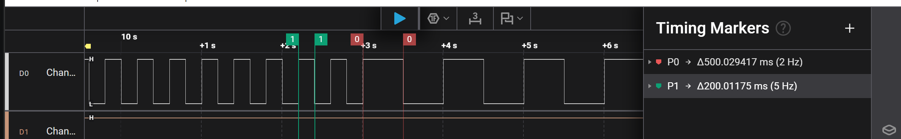
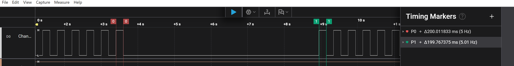
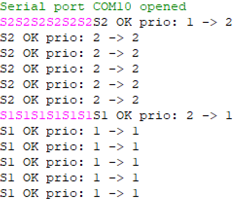
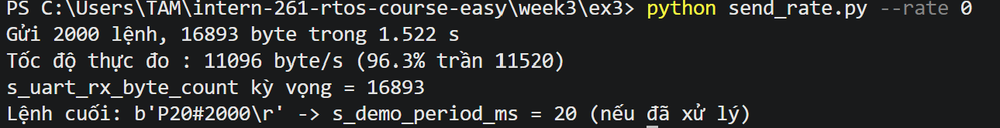
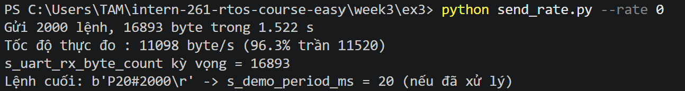

# Report — Week 3 / Ex3

`student_id`: __2413062____    Commit của PREDICTION.md: ______

## 1. Thời gian byte & độ sâu stream buffer
Phép tính thời gian 1 byte ở `RX_BAUD`, và số lệnh tối đa chứa được trong
`STREAM_BUFFER_BYTES`.
- Thời gian truyền 1 byte là: 10/115200=86.806(us). Số lệnh tối đa có thể chứa được trong `STREAM_BUFFER_BYTES` là 42 lệnh khi mọi lệnh đều ngắn nhất là 3 byte (vd T0\r, T1\r,...) và tối thiểu 5 lệnh khi mọi lệnh dài nhất (MAX_CMD_LEN = 24 byte; 128/24 = 5,33).
## 2. Demo 3 loại lệnh
Bằng chứng (log/ảnh) `demo_task` phản ứng đúng với `P`, `S`, `T` — mỗi loại ít
nhất 1 ví dụ có số liệu trước/sau.
- Phản ứng với `P`: ban đầu cho tín hiệu toggle 200ms, sau 5 lần gọi lệnh P500 thì tín hiệu toggle 500ms, minh chứng: 
- Phản ứng với `T`:ban đầu cho tín hiệu toggle 200ms, sau 6 lần lệnh T0 thì tín hiệu sẽ dừng, T1 sẽ toggle 200ms trở lại, minh chứng:
- Phản ứng với `S`: ban đầu, demo_task có priority là 1, sau 6 lệnh S2 nâng prior lên 2, sau lệnh S1, task trở về prior 1. Minh chứng: 
- Lí do phải gọi lệnh 5-6 lần do theo thông số của em có TRIGGER_LEVEL= 16 byte, mỗi lần gọi (S1\r, S2\r,T0\r) tốn 3 byte nên gọi 6 lần mới hơn 16 byte, lúc này lệnh mới được thực thi. Còn khi gọi lệnh P500\r tốn 4 byte nên gọi 5 lần là 20>16 byte, sau đó lệnh mới thực thi. 
- Trigger level là số byte tối thiểu phải có trong stream buffer thì task đang chờ (Blocked) mới được đánh thức.
## 3. Test gửi nhanh
| | Số lệnh gửi | Số lệnh nhận đúng | Mất/lỗi |
|---|---|---|---|
| Gõ tay bình thường | 16 | 16 | 0 |
| Gửi liên tục (script) | 1000 lệnh | 999 | 0 byte mất và lỗi, 1 lệnh chưa xử lí |

Nếu có mất byte: giải thích bằng cơ chế (stream buffer đầy, parser bị trễ,
hay nguyên nhân khác) — không chỉ nói "bị mất".
- Không mất byte trong cả 2 trường hợp.
- 1 lệnh chưa xử lí vì TRIGGER_LEVEL = 16 nên parser (chờ portMAX_DELAY) chỉ được đánh thức khi buffer có >= 16 byte. Lệnh cuối chỉ dài 9 byte, đến sau cùng nên nằm lại trong buffer, chưa được parser xử lý.
## 4. Vì sao stream buffer, không phải queue
Giải thích bằng lời của bạn.
- Với bài tập phần UART, ta thấy việc nhận dữ liệu liên tục dưới dạng 1 luồng byte liên tiếp thì stream buffers phù hợp hơn queue. Thêm vào đó, Stream Buffer hỗ trợ API xStreamBufferSendFromISR() nên có thể nhận dữ liệu trực tiếp từ ngắt UART.
- Ngoài ra, queue thường được dùng để truyền dữ liệu có kích thước cố định, còn trong bài tập này thì kích thước sẽ khác nhau với từng câu lệnh, giá trị để tạo 1 yêu cầu hoàn chỉnh. Nếu dùng queue thì mỗi byte sẽ là 1 phần tử riêng. 
## 5. Lệch so với dự đoán
Mỗi mục lệch + nguyên nhân.
| Các mục lệch | Dự đoán | Đo được | Sai số |Nguyên nhân|
|---|---|---|---|---|
| gửi lệnh bằng gõ tay bình thường có mất byte không| không | 0 byte |0|Do tốc độ gõ tay không nhanh bằng tốc độ xử lí của parser task|
| gửi lệnh bằng script có mất byte không| không | 0 byte mất và lỗi | 0 |Do tốc độ script cũng chưa bằng tốc độ xử lí của parser task|
## 6. Câu hỏi đánh đổi
Với `RX_BAUD` của bạn, nếu tăng gấp đôi `STREAM_BUFFER_BYTES`, tốc độ gửi tối
đa không mất byte tăng thêm bao nhiêu (đo thật, không suy luận)?
| STREAM_BUFFER_BYTES |Tốc độ thực đo cao nhất (byte/s) | Byte tới ISR / gửi | Mất / lỗi |
|---|---|---|---|
|128| 11096|16893 / 16893|0/0|
|256| 11096| 16893 / 16893|0/0|
- Ảnh minh chứng từ script:
+ 128 byte:

+ 256 byte:
